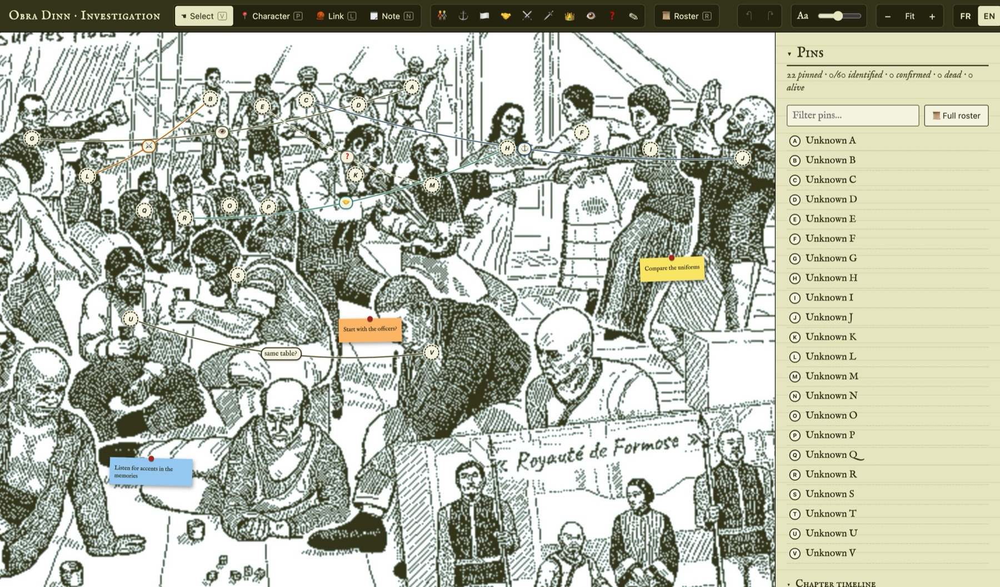

# Obra Dinn investigation board

A local "pin board" to help solve **[Return of the Obra Dinn](https://obradinn.com/)**: pin the crew on the game's group illustration, link people together, take notes, track hypotheses and follow who disappears chapter by chapter.

Everything runs locally: a tiny Node server serves a single HTML page and saves your board to a JSON file on disk. No dependencies, no build step, no account.

The interface is available in **French and English**.



<sub>Example board with placeholder data: pins are left unidentified so the screenshot doesn't spoil any fate.</sub>

## Features

- **Pins on the illustration**: place a numbered pin on each character, set their status (alive, dead, missing, unknown), their fate, and whether the game confirmed it. Pins and labels scale with zoom so the board stays readable.
- **Identity and hypotheses**: pick a crew member from the roster with a searchable selector, or keep several hypotheses on the same pin until you're sure.
- **Links between people**: draw threads between pins with an icon (family, same rank, same group, friends, conflict, killed, serves, seen together, hypothesis) or free text.
- **Sticky notes**: free-floating notes in several colors, anchored to the image, with copy/paste.
- **Crew roster**: a full-screen list of the 60 crew members and passengers with filters (role, origin, status, pinned, confirmed), first/last name search, sorting, a per-character note, and a hover preview of where each pin sits on the image.
- **Chapter timeline**: record in which chapter/part each person disappears, then filter the home panel, the roster and the board to show who is still present, who is gone so far, or who disappears at a given moment.
- **Multi-selection**: ⌘+click or Shift+drag to set status, fate, disappearance or hypotheses on many pins at once.
- **Display options**: show/hide each link type, names, fates, confirmed characters' pins and links.
- **Undo/redo**, autosave, and a backup of your board on each server start.

## Requirements

- [Node.js](https://nodejs.org/) 18 or later

## Getting started

```sh
git clone https://github.com/<your-account>/obra-dinn-board.git
cd obra-dinn-board
npm start
```

Then open <http://localhost:4321>. Use the `PORT` environment variable to change the port:

```sh
PORT=8080 npm start
```

The server only listens on `127.0.0.1`.

## Your data

- Your board is saved to `board.json` next to `server.js`, about half a second after each change.
- `board.backup.json` is a copy of the board taken when the server starts.
- Both files are git-ignored, so your investigation (and its spoilers) stays out of the repository.
- To start over, stop the server and delete `board.json`.

## Keyboard shortcuts

| Key | Action |
| --- | --- |
| `V` / `P` / `L` / `N` | Select / pin a character / link / note |
| `R` | Open the crew roster |
| `F` | Fit the image to the screen |
| Wheel, drag, `Space`+drag | Zoom and pan |
| `Alt`+drag a pin | Create a link |
| `⌘`+click, `Shift`+drag, `⌘A` | Multiple selection |
| `⌫` | Delete the selection |
| `⌘Z` / `⇧⌘Z` | Undo / redo |
| `⌘C` / `⌘X` / `⌘V` | Copy, cut, paste a note |
| `Esc` | Cancel / close |

## Spoilers

The bundled crew list (`characters.json`) only contains names, roles and origins. **It never includes fates**, so the board doesn't spoil the game. The chapter list in the timeline only gives chapter titles and how many parts each one has.

## Project structure

| File | Purpose |
| --- | --- |
| `server.js` | Minimal HTTP server: serves the page and reads/writes `board.json` |
| `index.html` | The whole application (HTML, CSS and vanilla JavaScript) |
| `characters.json` | Crew roster: number, first and last name, role, origin |
| `dessin.jpg` | The game's crew illustration used as the board background |

## Credits and license

- *Return of the Obra Dinn* is a game by Lucas Pope, published by 3909 LLC. This is an unofficial fan project, not affiliated with or endorsed by them.
- `dessin.jpg` is artwork from the game and remains © Lucas Pope / 3909 LLC. It is included only so the tool works out of the box, and it is not covered by this repository's license.
- The crew roster and chapter list come from the [Obra Dinn Wiki](https://obradinn.fandom.com/wiki/Characters), licensed under [CC BY-SA 3.0](https://creativecommons.org/licenses/by-sa/3.0/).
- The source code is released under the [MIT License](LICENSE).
